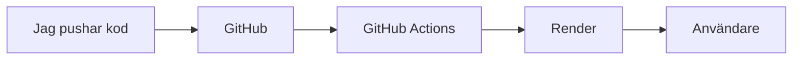
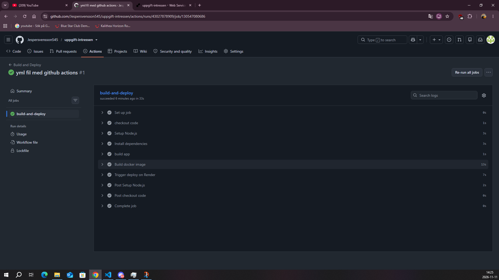
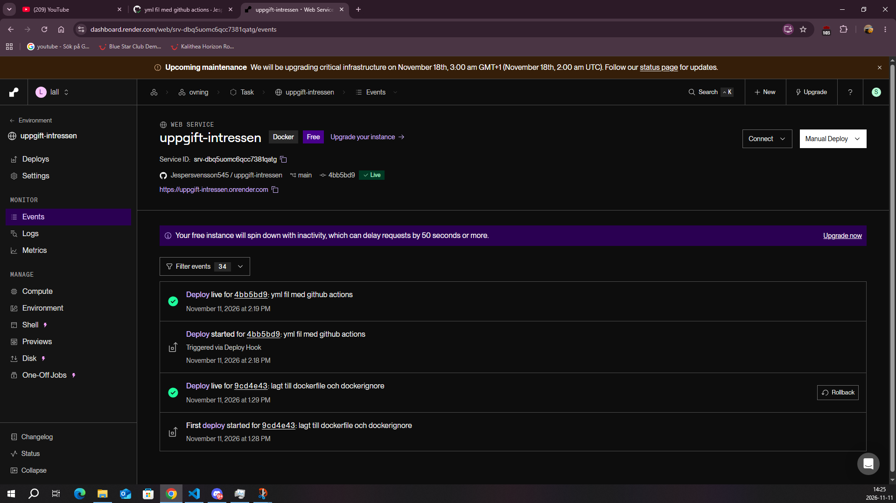
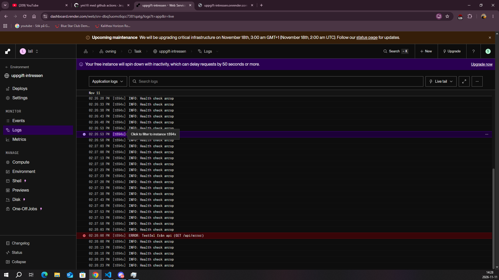

# Del 8

1. kort beskrivning om applikationen

svar: Det är en liten applikation där man kan skriva in vad man gillar föt intressen och en om sida som beskriver vad det är för sida. Intressena man skriver in sparas lokat i lockalstorage.
https://uppgift-intressen.onrender.com/

## Arkitektur

När jag pushar kod till GitHub startar GitHub Actions automatiskt och kontrollerar att appen och Docker-imagen kan byggas. Om allt fungerar säger GitHub Actions åt Render att driftsätta. Render bygger appen i en Docker-container, och användarna kan sedan besöka den via Renders länk.

2. Val av ramverk

Svar: Jag valde React med vite, vite är snabbt att starta och bygga med och react gör det enkelt att bygga interaktiva vyer med useState. för att kunna logga på servern så sa använde jag mig av express-server som visar /health enpointen. Navigeringen mellan om och hem sidan använde jag mig utav react-router.

3. instruktioner för att starta applikationen lokalt.

Svar: Först för att köra appen lokalt så behös node.js 22.

Sen kör du i terminalen
git clone https://github.com/jespersvensson545/uppgift-intressen.git
cd uppgift-intressen

Efter det så ska du ladda ner dependencies
npm install

Sen kopiera .env.example och döp kopian till .env
cp .env.example .env

För att starta appen i utveklingsläge
npm run dev

Öppna http://localhost:5173. Här körs Vites utvecklingsserver, och ändringar i koden syns direkt när man sparar. /healt syns inte i dethär läget eftersom dom ligger på express-servern

För att starta i produktionsläge
npm run build
npm start

Öppna http://localhost:3000. npm run build skapar en optimerad version av appen i mappen dist/, och npm start startar Express-servern som visar den. Det är samma sätt som appen körs på i Docker och på Render. Här fungerar /health, och loggarna syns i terminalen

4. Instruktioner för att bygga och köra Docker-containern.

Svar:

docker desktop ska vara installerat

Bygg imagen. Skriv detta i terminalen:
docker build -t intressen-app .

Sen kör containern

docker run --rm -p 3000:3000 intressen-app

Öppna http://localhost:3000. -p 3000:3000 kopplar port 3000 på datorn till port 3000 i containern, och --rm tar bort containern när den stoppas. Stoppa med Ctrl + C.

5. Beskrivning av miljövariabler och hemlighetshantering.

Svar:

Appen använder två miljövariabler. PORT bestämmer vilken port servern lyssnar på. Lokalt är den 3000, och på Render sätts den automatiskt av Render. APP_ENV visar vilken miljö appen körs i och syns i startloggen och i svaret från /health. Lokalt är den development och på Render production.

Lokalt ligger variablerna i filen .env, som står i .gitignore och därför aldrig pushas till GitHub. Filen .env.example visar vilka variabler som behövs. På Render har jag lagt in variablerna under Environment.

Deploy Hook-URL:en från Render är hemlig, eftersom alla som har den kan starta en driftsättning. Den är sparad som en GitHub-secret med namnet RENDER_DEPLOY_HOOK_URL och står aldrig i koden. Variabler som skickas till webbläsaren, till exempel de som börjar med VITE_, kan läsas av alla och får därför aldrig innehålla hemligheter.

6. Beskrivning av loggning och health check

Svar: Servern loggar viktiga händelser med console.info och console.error, och loggarna kan läsas under Logs i Render. När servern startar loggas till exempel "INFO: Server started on port 10000 (production)". Varje anrop till /health loggas också med console.info.

Om något går fel fångas felet av en felhanterare i Express, som loggar det med console.error, till exempel "ERROR: Testfel från api (GET /api/error)". Användaren får bara ett allmänt felmeddelande, så att inga interna detaljer visas. För att testa felloggningen finns endpointen /api/error, som medvetet kastar ett fel.

Endpointen /health svarar med {"status":"ok","environment":"production"} när servern fungerar. Render är inställt att anropa /health regelbundet (Health Check Path). Om den inte svarar räknas tjänsten som ohälsosam, och en ny driftsättning går inte live.

Vid felsökning börjar jag med att öppna /health. Svarar den fungerar servern, och felet ligger troligen i frontend eller i ett specifikt anrop. Svarar den inte är servern nere, och då kontrollerar jag i Render Logs om startmeddelandet finns och om det står några fel. Genom att söka på "ERROR" i loggarna hittar man snabbt felmeddelandena bland alla andra rader.

7. Beskrivning av github actions-workflowen

svar: Workflowen ligger i .github/workflows/deploy.yml och startar automatiskt varje gång jag pushar till main. Den körs på en Linux-maskin hos GitHub (ubuntu-latest) och går igenom följande steg i ordning:

1. Checkout code – hämtar källkoden från GitHub.
2. Setup Node.js – installerar Node.js 22.
3. Install dependencies – installerar beroenden med npm ci.
4. Build app – kör npm run build för att kontrollera att appen kan byggas.
5. Build Docker image – kör docker build för att kontrollera att Docker-imagen kan byggas.
6. Trigger deploy on Render – skickar en POST-förfrågan med curl till Renders Deploy Hook, som startar en ny driftsättning.

Deploy Hook-URL:en hämtas från GitHub-secreten RENDER_DEPLOY_HOOK_URL och står aldrig i workflow-filen. Ingen image publiceras på Docker Hub, eftersom Render bygger sin egen image från Dockerfile.

Om något av stegen misslyckas, till exempel om koden inte går att bygga, stoppas workflowen direkt och resterande steg körs inte. Då anropas aldrig Render, och den senaste fungerande versionen av appen ligger kvar live.

8. Förklaring av hur Render-driftsättningen fungerar.

Svar: Appen körs som en Web Service på Render med runtime Docker och instanstypen Free. Tjänsten är kopplad till mitt GitHub-repo och branchen main. Render bygger en egen image från min Dockerfile och startar en container från den, så ingen image behöver publiceras på Docker Hub.

Auto-Deploy är avstängt. Annars skulle Render driftsätta vid varje push, även om koden inte gick att bygga. I stället är det GitHub Actions som styr driftsättningen: först när byggstegen har lyckats anropas tjänstens Deploy Hook, som är en hemlig URL som startar en ny driftsättning. I Render Events syns det som "Triggered via Deploy Hook".

Vid en driftsättning bygger Render imagen, startar en ny container och anropar /health (Health Check Path). När /health svarar går den nya versionen live, och den gamla containern stängs av. Om den nya versionen inte svarar ligger den gamla kvar.

Render sätter miljövariabeln PORT själv (10000), och servern läser den med process.env.PORT. Servern lyssnar på 0.0.0.0 i stället för localhost, så att Render kan nå den inifrån containern. Miljövariabeln APP_ENV=production är inlagd under Environment.

# kostnadsmedveten drift 7:

1. Vilken Render plan använde du och varför?

svar: Jag använde mig utav Hobby och tjänsten körs på instansen free, då den va gratis och passar till en såhär liten uppgift.Det är också bara jag och läraren som kommer "använda" den så det behövs inga stora mängder med services eller bandwidth då gratisverisionen har 5GB bandwidth.

3. vilka faktorer påverkar kostnaden för att driva applikationen?

svar: Den största faktorn är nog hur många som ska använda applikationen, eftersom det bara är 2 personer så behövs det inte en större plan då servern kan ta han om oss. Hade det vara fler som skulle använt den så skulle man kanske kollat på en lite dyrare plan kanske PRO eller Scale beroende på vad man ska bygga och och hur många som bygger. Sen får man kolla lite på vilken compute plan man ska ha där instances räknar in tex nu på free så kommer 0.1cpu och 512mb ram men sen kan man välja en plan på 1500 dollar i månaden som ger 12 cpu och 96 gb ram använding till instanserna. Det skulle vara om man har en myyycket större applikation dock.

4. Hur kan du minsa applikationens resursanvändning?

svar: jag använder en litenbasimage node:22-alpine som är mycket minde än vanliga node-image. Det gör att bygget går fortare och mindre diskanvändning. Jag använder mig inte utan någon databas utan sparar svaren på lockalstorage så servern behöver ingen databas eller lagring som tar upp resurser. Sen stängde jag av auto-deploy som jag skulle och det gör att render bygger bara när github-actions har kontrollerats och funkar.

5. vilka begränsingar har din nuvarande driftlösning?

Svar: Servern stängs ner efter 15 minuter utan trafik och nästa användare får vänta lite för att den ska starta igen. Den har bara 1 instans som gör att om servern krashar eller startas om så är den nere tills den kommer upp igen, det finns alltså ingen reserv.sen har den inte så mycket rem och cpu som gör att den inte kan hantera för många användare. den kan också bara vara igång vist antal timmar i månaden.

6. vad skulle du behöva förändra om applikationen fick betydligt fler användare?

svar: Jag skulle behöva byta plan till en som inte somnar och som har mer cpu och ram, så den kan klara fler anrop och slipper onödig väntetid. Sen kan man göra fler instanser som fördelar trafiken, det gör att om tex en instans skulle krasha så fungerar fortfarande dom andra och trafiken dirigeras dit istället. Sen skulle jag också behöva skapa en databas typ som postgreSQL och då behövs api-routs i express. En till sak kanske kan vara larm vid fel eller när /health slutar svarar.

## Skärmbilder

